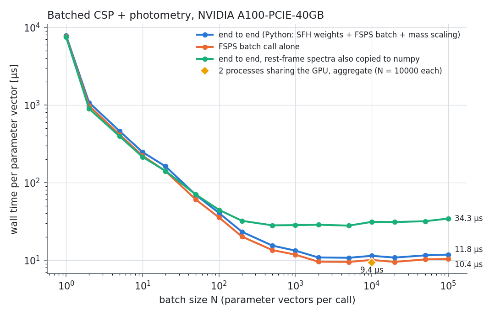
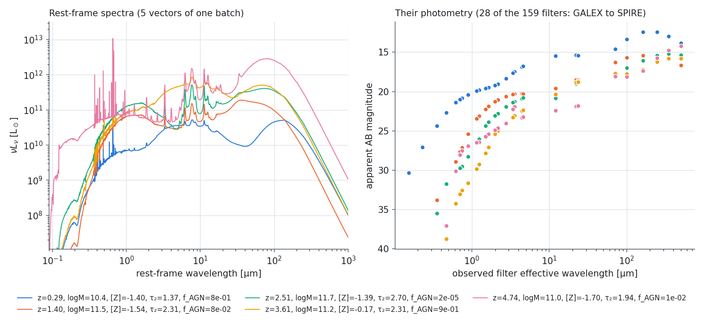

# Batched CSPs for SED-fitting samplers (A100 demo)

`demo_batch_sed.py` evaluates N parameter vectors per call through the C API's
`fsps_context_compute_csp_batch` (ctypes, `fsps_batch.py`). Every vector has its own value of
every fitting parameter, drawn independently, as a sampler proposes them. The timed step runs
from parameter arrays in numpy to SEDs in numpy: photometry, spectral indices, line
luminosities, surviving mass fraction, L_bol, dust mass, and optionally the full spectra.

Results here: `results_a100/` (A100-PCIE-40GB, nvhpc 25.1, OpenACC FP32 kernels + cuBLAS,
`-Dkernel_precision=single -Daccel=gpu -Dcublas=true`, 2026-10-19, GPU not shared during the run).

## Headline

| Wall time per parameter vector (median, N = 2,000 ... 100,000) | µs |
|---|---|
| End to end in Python: SFH weights + FSPS batch call + mass scaling, photometry and properties to numpy | **10.7 - 11.8** |
| ... of which the FSPS batch call | 9.5 - 10.4 |
| ... of which GPU kernels and transfers (Nsight Systems, N = 10,000) | ~7.4 - 7.6 |
| 2 processes sharing the GPU (two sampler workers), aggregate, N = 10,000 each | **9.4** |
| End to end, also copying the 5,994-pixel spectra to numpy | 28 - 34 |



Batches of ~2,000 or more reach the asymptote; at N = 100 it is ~40 µs and at N = 10 ~250 µs
(per-call launch and set-up overhead).

**N = 1 costs 7.7 ms.** With one vector, the batch uses its "shared redshift" path, which
rebuilds the redshift grid (filter transposes, IGM) whenever z changes, as it does for every
draw here. From N = 2 the per-vector-redshift path is used. This is not tuned.

### What the earlier 6.5-7.2 µs figures measured

`doc/GPU_RESULTS.md`'s 6.5 / 7.2 µs (cuBLAS / OpenACC, FP32, "full physics") came from
`benchmark_csp_batch`, timed in Fortran: magnitudes + indices, with redshift and metallicity
shared by the whole batch, and tau, age, U_min and gas_logu varying. Here every parameter
varies, including z (per-vector IGM, observed-frame resampling and distance) and logzsol
(per-vector interpolation between the 12 resident SSP bases). The time is also measured from
Python and includes the host work. The GPU part alone is still 7.4-7.6 µs/vector; the
remaining ~3 µs is host time:

| Host time per vector at N = 10,000 | µs |
|---|---|
| Python: SFH weight matrix (numexpr) | 1.0 |
| Python: scaling outputs to each vector's mass | 0.3 |
| C API: per-vector parameter sets | 0.6 |
| Batch: validation, metallicity brackets, dust / AGN / nebular indices | 0.5 |
| Batch: device allocation and copy-in of the working arrays (~1.2 GB at N = 10k) | 0.4 |
| Output copies and conversions | 0.4 |

A second process hides part of this (9.4 µs aggregate); a third does not help further, since
the GPU is then nearly saturated. Two threads in one process do not work: concurrent batches on
two contexts crash, so the library is not thread-safe for concurrent batches yet.

## Fixed for the whole batch (shared by every vector)

Everything that defines the SSPs, plus a few switches. These are FSPS settings, not
simplifications made for the batch; a non-batched FSPS fit fixes them in the same way.

- Libraries: MIST isochrones, MILES stellar spectra (FSPS's `miles` spectral library), Draine &
  Li 2007 dust emission templates.
- IMF: Chabrier 2003 (`imf_type = 1`).
- SSP basis: 12 metallicities x 107 ages (log t = 5.0 ... 10.3) x 5,994 wavelengths, built
  once (1.4 s, first call) and kept on the GPU. Each vector's logzsol interpolates between
  the two bracketing bases, as FSPS's `compute_interpolated_ssp` does: linear in spectra and
  mass, linear in log L_bol.
- Attenuation law: Kriek & Conroy 2013 (`dust_type = 4`; the per-vector `dust_index` sets its
  slope). Birth-cloud dust (dust1) acts on stars younger than `dust_tesc = 7` (10 Myr),
  `dust1_index = -1`; `frac_nodust = 0`.
- Nebular emission on (`add_neb_emission = 1`, continuum and lines, lines also in the
  spectrum), `frac_obrun = 0`.
- Dust emission on (energy balance, DL07). AGN torus emission on (Nenkova et al. 2008
  templates). IGM on (Madau 1995, `igm_factor = 1`).
- Cosmology: flat ΛCDM, H0 = 70, Ωm = 0.3 (distances and the t_univ(z) limit of the SFH).
- Filters: **all 159** FSPS filters are integrated for every vector (GALEX ... JWST ... Herschel,
  LSST, Euclid, Roman). A typical fit uses 10-30, so this overstates the photometry cost.
- AB magnitudes, vacuum wavelengths, stellar remnants counted in the mass, no velocity
  smoothing (`--smooth SIGMA` turns it on; then σ is shared by the batch).

## Varied per vector (independent draws; no two vectors share a value)

Prospector-α-like priors (Leja et al. 2017, 2019):

| Parameter | Prior | Acts as |
|---|---|---|
| logmass | U(8, 12) | stellar mass formed; scales the outputs (Python, timed) |
| logzsol | U(-1.98, 0.19) | stellar metallicity; SSP-basis interpolation per vector |
| logsfr_ratios (6) | Student-t, df = 2, scale 0.3 | 7-bin continuity SFH, see below |
| dust2 | U(0, 4) | diffuse dust optical depth |
| dust_ratio | U(0, 2) | dust1 = dust_ratio × dust2 (birth clouds) |
| dust_index | U(-1, 0.4) | attenuation slope |
| fagn | log-U(1e-5, 3) | AGN torus luminosity / stellar L_bol |
| agn_tau | log-U(5, 150) | torus optical depth |
| gas_logz | U(-2, 0.5) | gas-phase metallicity (CLOUDY grid) |
| gas_logu | U(-4, -1) | ionization parameter (CLOUDY grid) |
| duste_umin | U(0.1, 25) | DL07 U_min |
| duste_gamma | log-U(1e-3, 0.15) | DL07 γ |
| duste_qpah | U(0.5, 7) | DL07 q_PAH |
| zred | U(0.05, 5) | redshift: observed frame, IGM, distance, SFH age limit |

`results_a100/results.json` (`n_unique`) records that each of these had 10,000 distinct values
in the 10,000-vector batch.

**SFH.** Continuity SFH in 7 lookback-time bins: 0-30 Myr, 30-100 Myr, four log-spaced bins up
to 0.85 t_univ(z), then the rest up to t_univ(z). The SFR is constant within a bin. The weight
of each SSP age is the mass formed in the lookback interval that age represents (edges at the
log-midpoints of the age grid), so ages older than the universe at that vector's z get none.
This weight matrix (107 × N), computed per call in Python and included in the timing, is
passed as `ssp_weights`.

## Physics and observational steps applied to each vector (all inside the timing)

On the GPU, per vector (`src/physics/fsps_csp_batch.f90`):

1. SFH weights → mass and L_bol of the interpolated SSPs; young/old split at dust_tesc.
2. Age sums: spectrum = Σ_ages weight × SSP(age, Z interpolated).
3. Nebular emission from the CLOUDY grid at the vector's gas_logz, gas_logu and SFH: ionizing
   photons Q(t), continuum and 166 lines, line profiles added to the spectrum.
4. Attenuation: birth-cloud and diffuse dust, lines included; the absorbed luminosity is
   tracked.
5. Dust emission: energy balance, DL07 template interpolated at U_min, γ, q_PAH.
6. IGM transmission at the vector's z; AGN torus emission (fagn, agn_tau), attenuated by the
   diffuse dust.
7. Observed frame at the vector's z: resampled spectrum, (1 + z) and luminosity-distance
   terms, then all 159 filter integrals → apparent AB magnitudes.
8. 30 spectral indices (Lick, D_n4000, near-IR) on the rest-frame spectrum.

Returned to numpy per vector: 159 magnitudes, 30 indices, 166 line luminosities, surviving
stellar mass per mass formed (mfrac), log L_bol, dust mass, and with `--spec` the rest-frame
spectrum (L☉/Hz). Python then scales the extensive outputs to the vector's mass.

Not timed: the prior draws (a sampler's job), the context set-up (20.6 s, once per process),
and the first call (1.4 s, builds the 12 SSP bases and moves the context to the GPU).

## Correctness checks (in `results_a100/`)

- **Per-vector parameters really are per vector:** 24 random vectors of a 10,000-vector batch
  recomputed one per call, with their parameters set as ordinary context settings (the
  non-batched way): magnitudes 6e-7 mag, spectra 4e-16, lines 4e-16, indices, mass and L_bol
  identical (`run.log`).
- **Against an independent CPU FP64 build** (gfortran 13.4, `--replay`): magnitudes 4.8e-7 mag,
  spectra 6.1e-7, lines 3.6e-7, dust mass 1.4e-7, mfrac 7e-16, L_bol 4e-15 dex; indices 1.3e-5
  absolute (Å or mag; the worst relative case is a 0.035 Å equivalent width). This is FP32
  kernels vs FP64 (`replay_cpu_fp64.log`).
- The repository's `test_csp_batch` compares the batch with `compute_csp_scenario` (the
  classic one-model-at-a-time FSPS path) for these physics groups; unit + regression pass
  33/33 in the builds used here.



## Running it

```sh
module load nvhpc/25.1
FC=nvfortran CC=nvc meson setup build_gpu32cb --buildtype=release -Daccel=gpu \
    -Dkernel_precision=single -Dgpu_arch=cc80 -Dcublas=true
ninja -C build_gpu32cb
unset SPS_HOME; export FSPS_DATA_HOME=$PWD        # the repository's data tree
cd demo/sed_sampling
python3 demo_batch_sed.py --describe --lib ../../build_gpu32cb/libfsps.so   # the setup
python3 demo_batch_sed.py --lib ../../build_gpu32cb/libfsps.so --spec --out results_a100
python3 throughput_processes.py ../../build_gpu32cb/libfsps.so 10000 2 10 > results_a100/throughput_processes.txt
# CPU FP64 cross-check (gfortran build_cpu):
python3 demo_batch_sed.py --lib ../../build_cpu/libfsps.so --replay results_a100/vectors.npz --out results_a100
```

Requires numpy and matplotlib; numexpr is optional (the SFH weights fall back to numpy,
~3 µs/vector instead of ~1).

## Library changes made for this demo (commit e1416c6)

- `fsps_context_compute_csp_batch` set every per-vector parameter through the string-keyed
  setter: ~0.7 µs per call on this host, 9 of 18 µs per vector with 12 parameters. Names are
  now looked up once per batch (one table of the `PARAMS` float components, also used by the
  setter): the call went from 18.6 to 9.5 µs/vector.
- C getters for a context's SSP age grid, wavelengths and filter effective wavelengths.

## What would close the gap to ~7-8 µs end to end

- Per-vector-metallicity age sums (1.5 µs/vector): in cuBLAS builds, sort vectors by
  metallicity bracket and run two GEMMs per bracket instead of the portable kernel.
  Estimated ~1 µs/vector saved.
- Host set-up inside the call (~1.5 µs): reuse the device working arrays between calls of the
  same N, and build the per-vector indices on the device.
- Nebular continuum (2.3 µs/vector): the largest kernel; already restructured once (see
  `GPU_RESULTS.md`).
- Thread-safe concurrent batches on separate contexts, so one process can overlap host and
  GPU work (instead of two processes).
